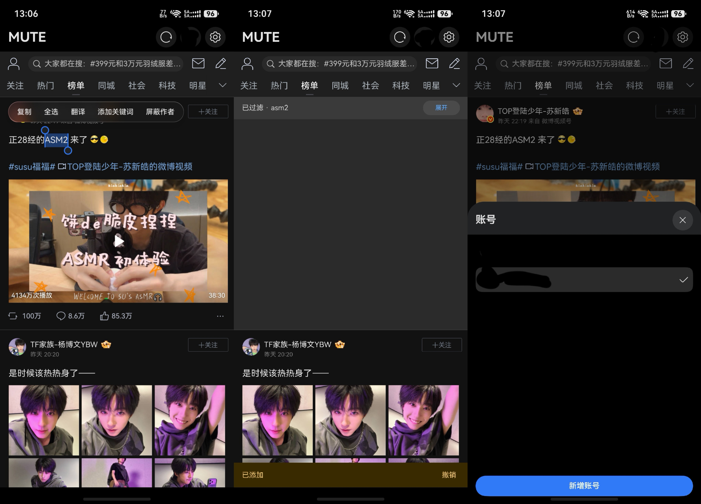
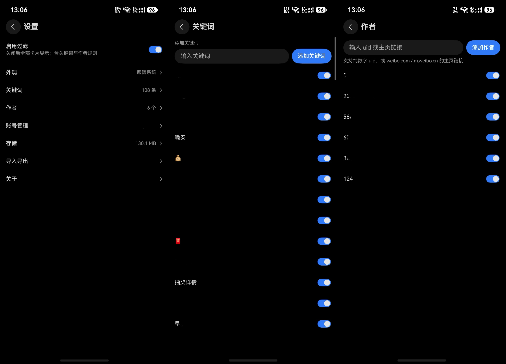
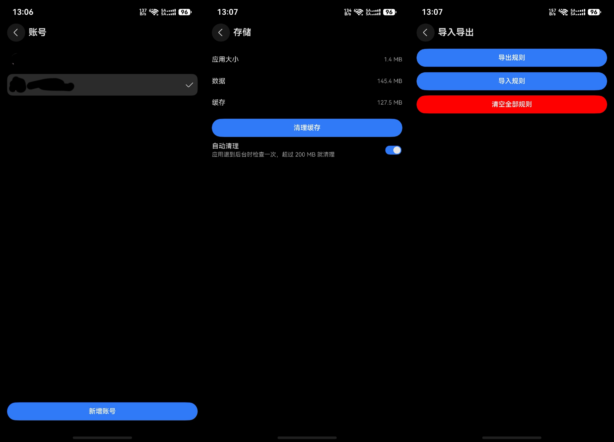

# MUTE

> [!IMPORTANT]
> This repository has been developed with AI assistance.

A HarmonyOS client for [Weibo](https://weibo.com).

Hide timeline posts that match your keywords or authors.

_Only tested on Mate 60 Pro._

## How It Works

The app loads `m.weibo.cn` in an ArkWeb `Web` component and injects a script that hides matched posts in place. The script runs at document start and keeps watching the timeline, so filtering survives scrolling and lazy loading.

It does not use the Weibo open API, does not reverse-engineer any Weibo endpoint, and does not connect to any third-party service. Account cookies never leave the device.

## Screenshots

<picture>
  
  
  
  
</picture>
